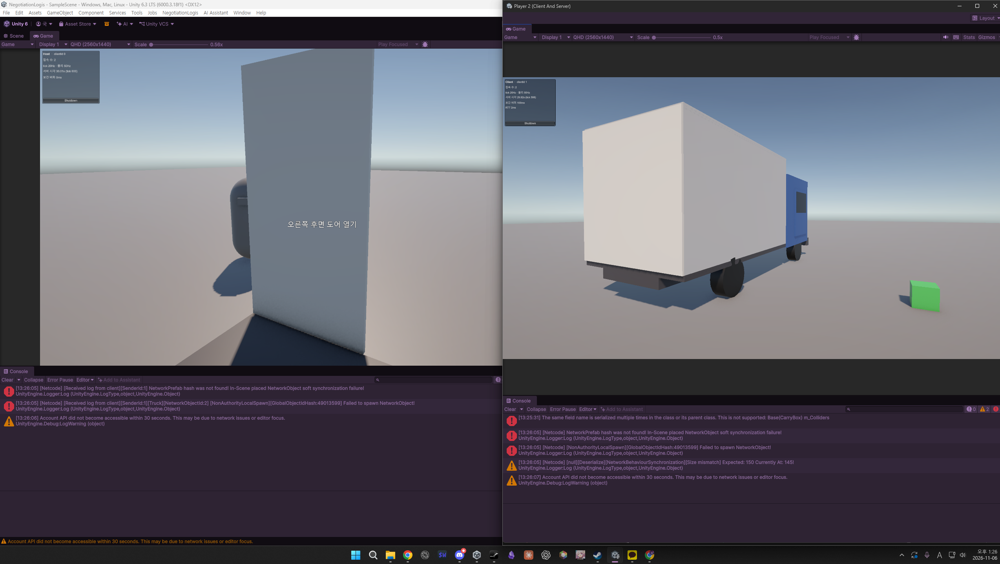

솔플 게임 만들 때는 그냥 플레이어가 움직이면 움직이는 거고, 상자를 던지면 날아가는 거였는데

무슨 호스트가 어쩌구 클라이언트가 어쩌구 포트 맞춰야 접속되고 크아악

포트 같은 건 옛날에 마인크래프트 서버 열 때나 보던 건데...

## 누가 처리하는가!!

멀티에서는 누가 처리하는지가 중요했음. 
호스트(서버 주인)가 할지 클라이언트(서버에 접속한 인간들)가 할지

플레이어 이동 같은 거를 호스트에서 처리하면 호스트 컴퓨터가 아파할 것 같아서 그리고 느릴 거라서 각자 컴퓨터에서 처리하고

상자나 트럭 같은 여러 명이 함께 쓰는 건 호스트가 처리하게 만들고 있는데 맞는 방법인지는 모르겠다

상자 집거나 문 여는 거는 호스트한테 허락받고 열리게 하고 모두한테 알려주는 방식으로 구현했다.

스페이스타임슈터나 바들바들 만들 때는 이런 거 생각 안 하고 만들어도 돼서 좋았는데 머리 아프다 ㅋㅋ

## 서로 다르게 보임

만들다가 호스트가 모두한테 알려 주는 걸 안 하니까 생긴 일 ㅋㅋ

이거 말고도 호스트에서는 상자가 바닥에 있는데 클라이언트에서는 떠 있거나,
한쪽에서는 문이 열렸는데 다른 쪽에서는 닫혀 있고,
클라이언트가 트럭에서 내리니까 호스트의 트럭이 날아가기도 함.

얼탱이가 없긴 했는데 재밌긴 하다.

그냥 솔플겜에 멀티 기능 딸깍 붙여서 될 줄 알았는데 멀티로 만드려면 아예 코드 구조가 다른 걸 몸소 깨닫는 중

아직 같은 PC에서 테스트하는 중인데도 고려할 게 정말 많다.

그래도 재밌다.
