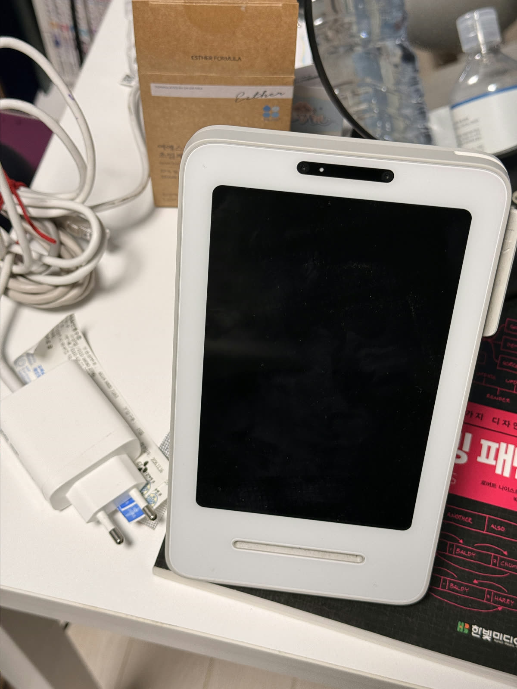
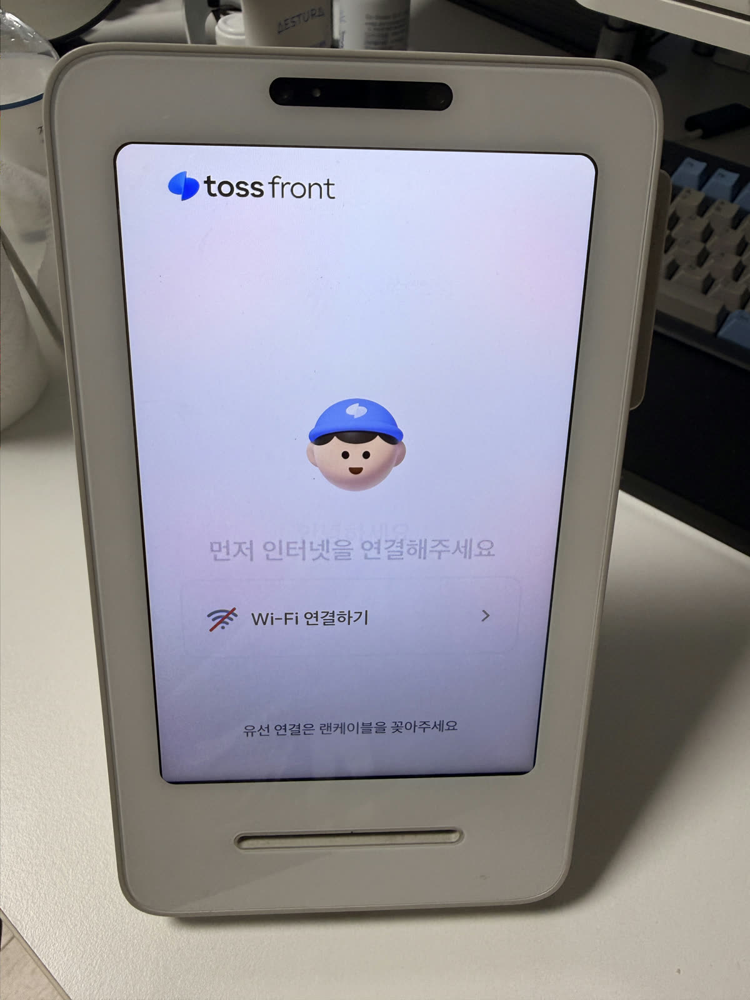
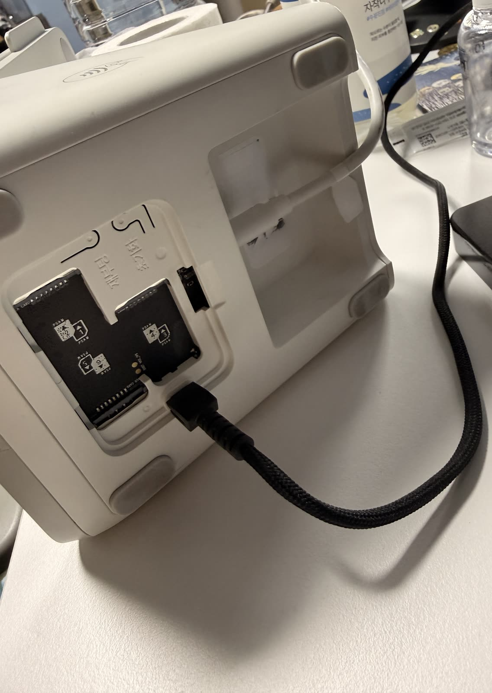
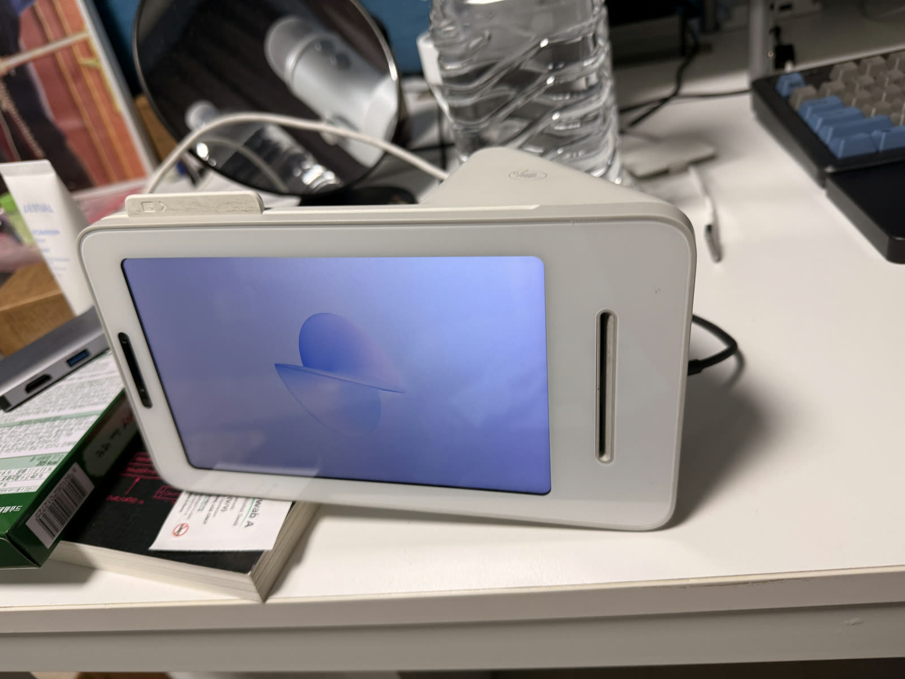
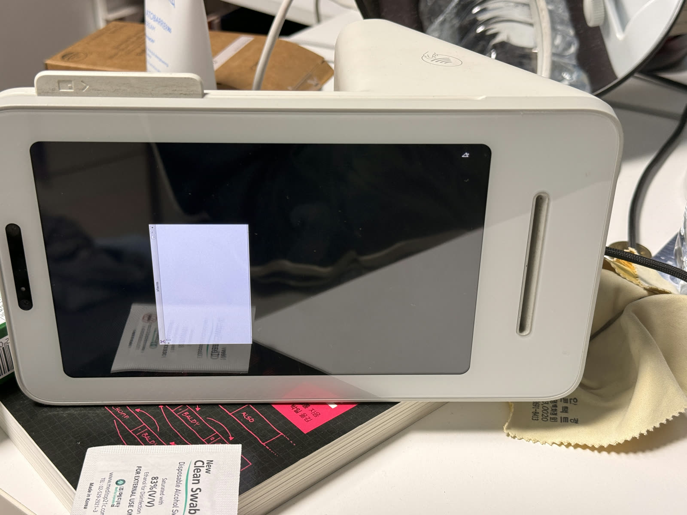
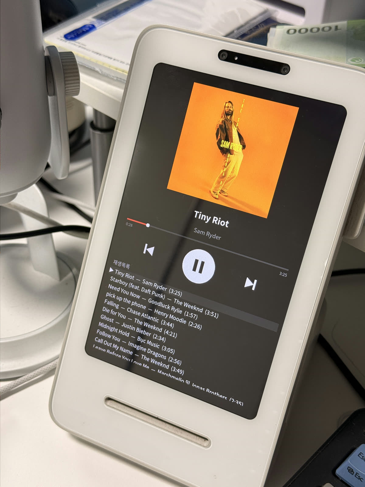
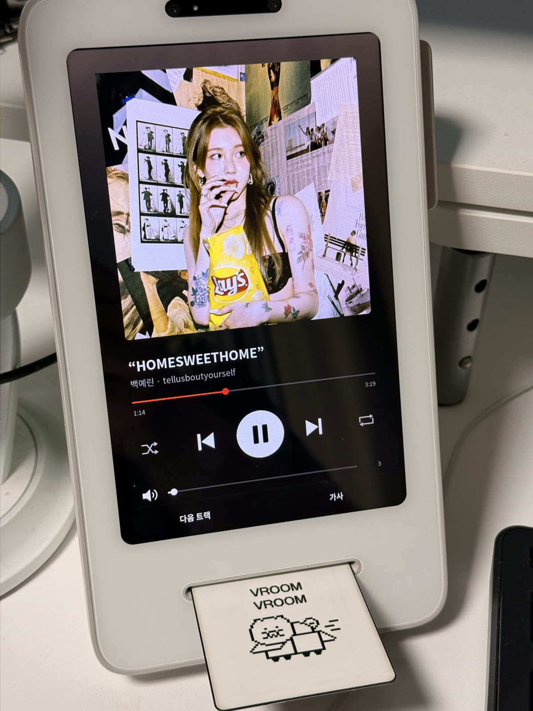

토스 프론트로 음악 플레이어 만드는 걸 SNS에서 
보고 갖고 싶어서 당근했다.

<figure class="photo-figure">
  
  <figcaption>(무려 3만 원짜리)</figcaption>
</figure>

이 녀석을 내 맘대로 사용하기 위해서 
귀찮은 작업을 해 줘야 한다

  
  
  
  

지루하고 현학적인 과정을 거치고 (리눅스를 설치하는 과정)

나만의 유튜브 뮤직 플레이어를 만들었다 ㅋㅋ

UI 좀 깎아주면~

카드도 들어가고 터치도 되는 뮤직 플레이어 완성!!

토스 프론트 생긴 게 예뻐서 맘에 든다

왜 이런 게 재밌지...

다음에는 디지털 피규어 기능을 만들어 봐야겠다
