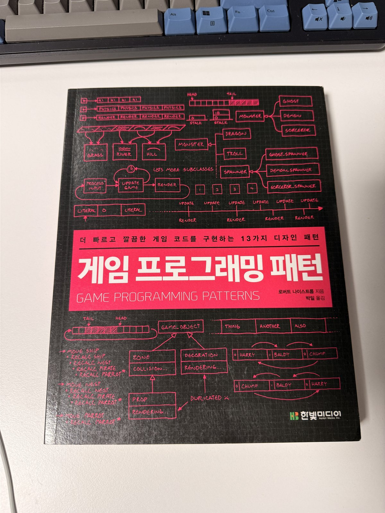

AI를 쓰게 되니까 내가 멍청해지는 거 같은 기분이 든다 
코드를 안 본 지가.. 벌써 바들바들 만들 때가 마지막인 거 같다..

26년 4월달이니까 너무 오래된 거 같은데???

그래서!

사기만 하고 안 읽어 본 책 읽으면서 공부 좀 해야겠다

C++ 예제 코드라니까 이거 이해해 보면서 
C#으로 바꿔야지

물론 의미 없는 짓일 수도 있지만

똑똑해지는 기분도 느껴 봐야지

코드도 좀 봐야 한다는 생각이 든다.

물론 나보다 클로드가 5조 5억 배 잘 짜지만 
클로드가 짠 거 이해는 해야

어떤 식으로 구현돼서 돌아가는지 알 수 있으니까.

늘 느끼는 거지만 AI 쓰면 쓸수록 바보 되는 거 같다 
근데 원래라면 하지 못할 것도 이 녀석들 덕분에 할 수 있는 게 좀 크다

요즘 들어 많이 느낀다

게임랩에서 할 때만 해도 이 멍청한 녀석 하고 혼냈던 게 엊그제 같은데...
