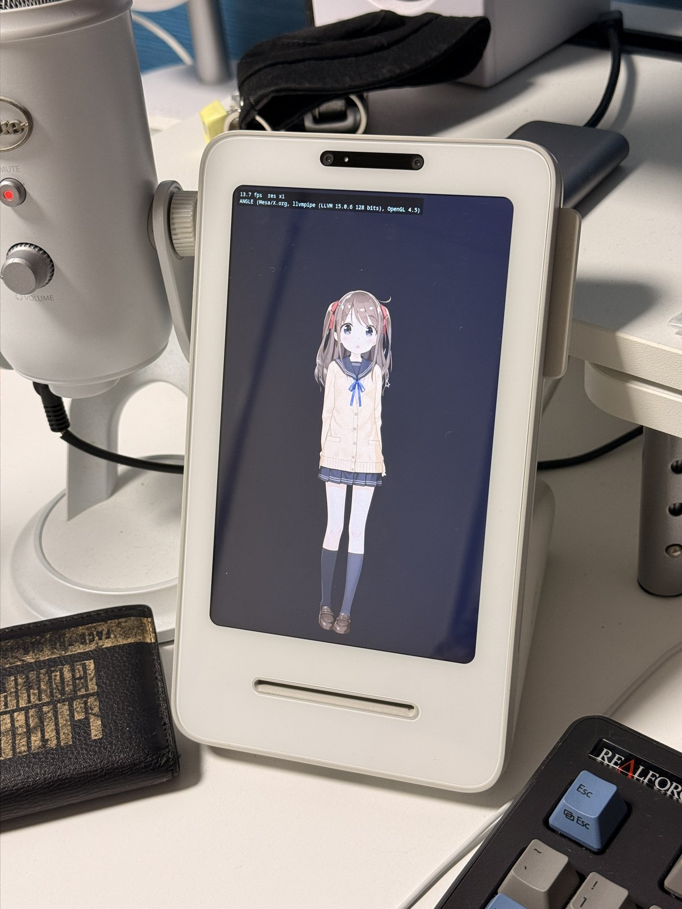
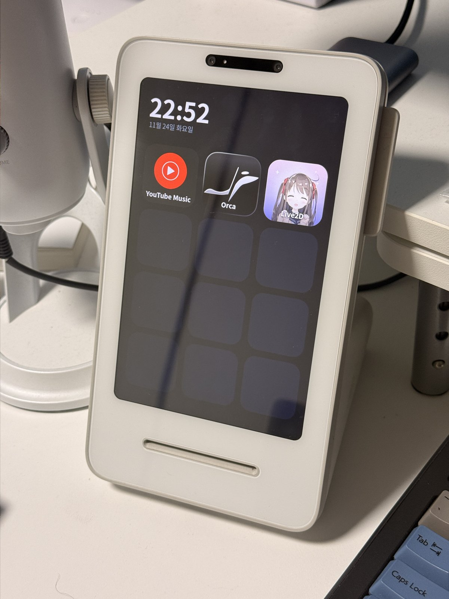
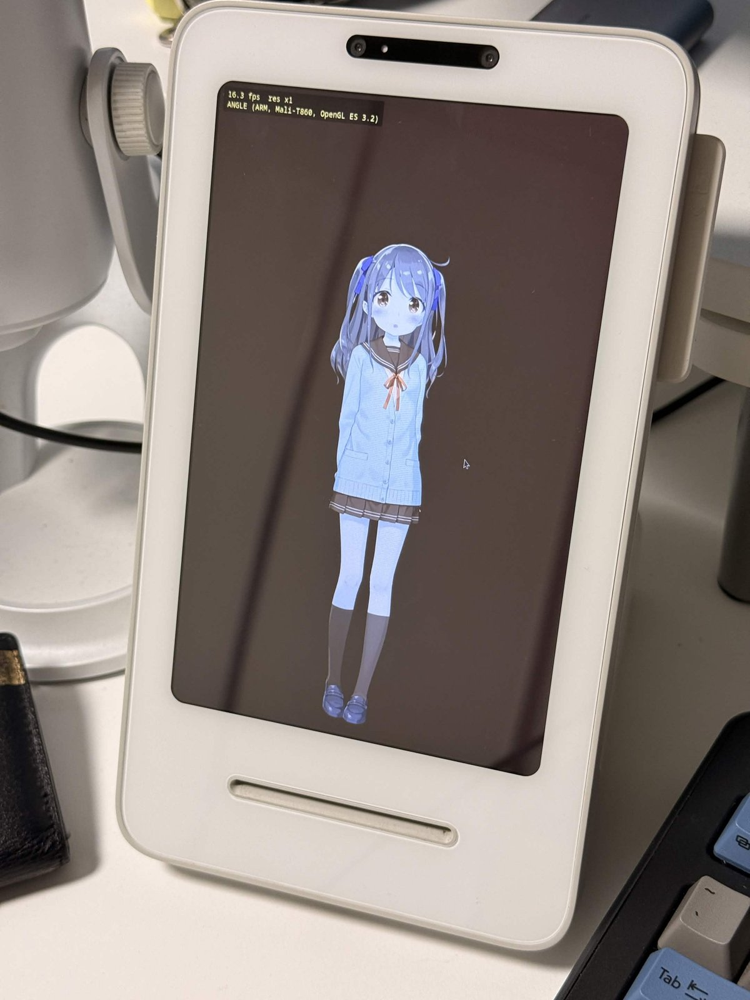

디지털 피규어를 만들기위한 첫번째 단계 
Live 2d를 토스 프론트에 띄워야한다!

클로드형님 잘 부탁드립니다!

바로 해줬다

(역시 클햄이야!)

뭐 지루한 과정을 거쳐서 
15프레임 정도 나오게 만들었다.

<figure class="photo-figure">
  <video src="/assets/toss-front-live2d-02-zoom.mp4" poster="/assets/toss-front-live2d-02-zoom-poster.jpg" autoplay loop muted playsinline aria-label="토스 프론트에서 Live2D 히요리를 확대 축소하는 모습"></video>
</figure>

확대 축소 기능까지 넣었다 ㅋㅋ

이제 Live 2d 모델과 배경바꾸기 기능정도 만들면 디지털 피규어도 완성이다.

주변 그림쟁이들한테 부탁해야 가능하겠지만...

유튜브 뮤직 플레이어랑 Live 2D 왔다갔다 할수있게

스트림덱 처럼 만들었다. 
유용한 도구로 진화중!(오르카 바로켜기 버튼ㅋㅋ)

<figure class="photo-figure">
  
  <figcaption>(GPU 써본다고 했다가 파란색으로 나오는 버그가 있었지..)</figcaption>
</figure>

RGB 말고 어째서 BGR을 쓰는거냐!!

<small>모델: Live2D Inc. 샘플 모델 "모모세 히요리(桃瀬ひより)"</small>
